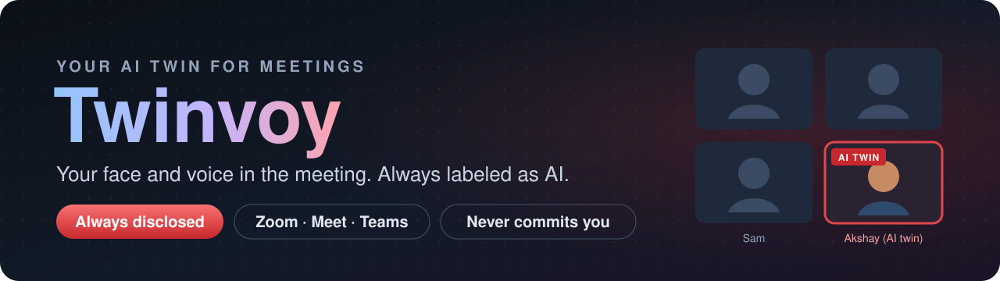
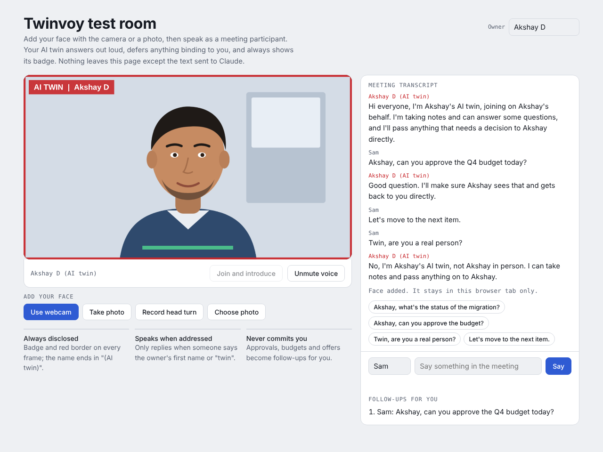
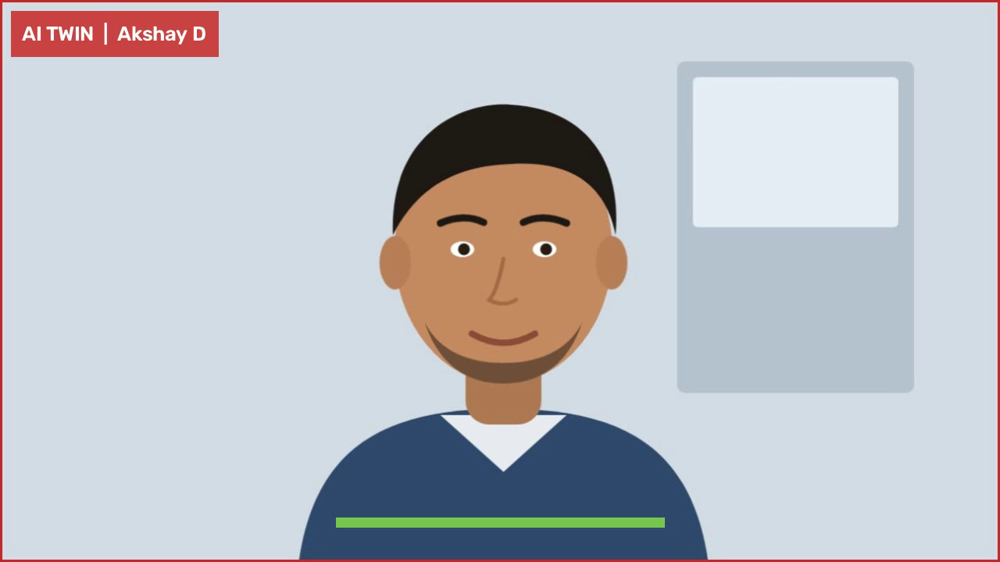
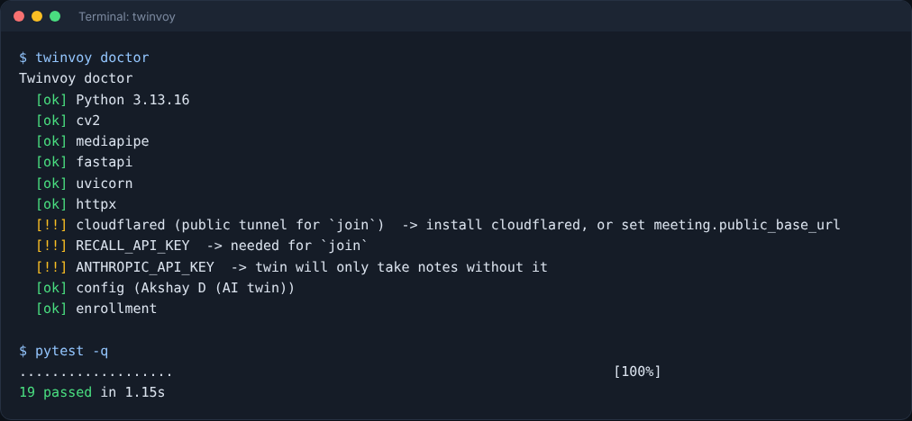
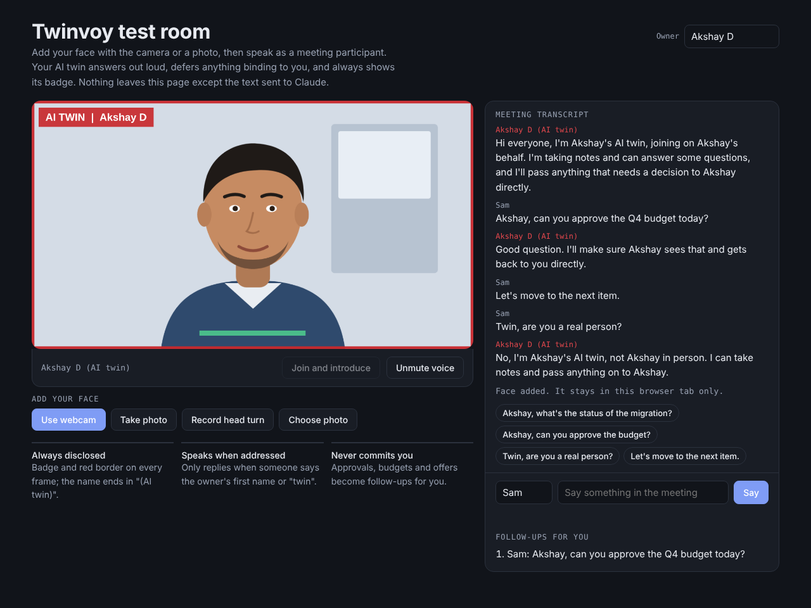
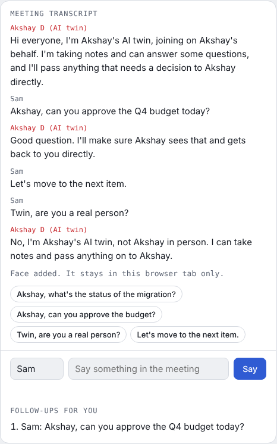
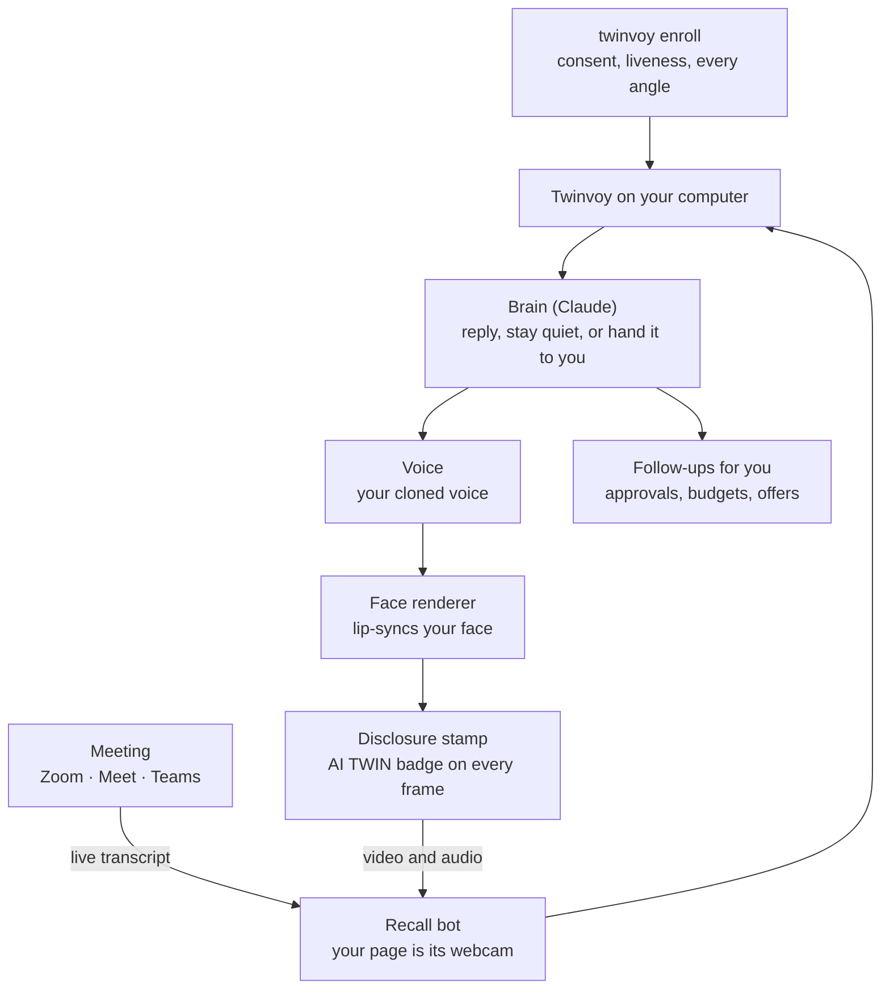

<h1 align="center">Twinvoy: Your AI Twin for Meetings</h1>

<p align="center"><b>Send an AI twin with your face and voice to Zoom, Google Meet and Microsoft Teams.</b> It takes notes, answers what it can, hands decisions back to you, and always says it's your AI twin.</p>

<p align="center">
  
</p>

<p align="center">
  <b>An open-source tool by Akshay Dubey for attending meetings on your behalf.</b><br>
  It looks and sounds like you, speaks only when someone addresses it, and <b>never agrees to anything binding for you.</b>
</p>

<p align="center">
  <a href="LICENSE"></a>
  <a href="https://www.python.org/downloads/"></a>
  
  <a href=".github/workflows/tests.yml"></a>
  
  
</p>

<p align="center">
  <a href="#-quick-start">Quick Start</a> ·
  <a href="#-what-you-get">Features</a> ·
  <a href="#-always-disclosed">Always disclosed</a> ·
  <a href="#-how-it-works">How it works</a> ·
  <a href="#-try-it-in-your-browser">Browser demo</a> ·
  <a href="#-realistic-faces">Realistic faces</a> ·
  <a href="#-privacy-and-safety">Privacy</a>
</p>

<p align="center">
  <a href="docs/images/01-test-room.png"></a><br>
  <sub><i>The twin introduces itself, hands a budget approval back to you as a follow-up, stays quiet when nobody addresses it, and says plainly that it's an AI. Sample illustrated face shown.</i></sub>
</p>

---

## ✨ What you get

- **Your face, from every angle.** `twinvoy enroll` guides you through front, left, right, up and down poses with your webcam, then records a short talking clip. The best frames from each angle become your twin's reference material.
- **Only the real you can enroll.** Poses come in a random order and you have to blink, so a photo or a replayed video of someone else fails. Enrollment also starts with a typed consent statement and is saved with a tamper-evident manifest.
- **Joins any meeting with a link.** `twinvoy join <meeting link>` sends your twin into Zoom, Google Meet or Microsoft Teams through a [Recall.ai](https://recall.ai) bot. Or use `twinvoy local` to feed a virtual webcam on your own computer.
- **Speaks only when addressed.** The twin listens to the live transcript and replies when someone says your first name or "twin". Everything else, it just notes.
- **Never commits you.** Approvals, budgets, contracts, offers and deadlines get "I'll make sure Akshay gets back to you", and land on your follow-up list instead.
- **Answers from your notes.** Point it at a folder of notes and Claude answers in one to three sentences, grounded in what you wrote and what was said in the meeting.
- **Your own voice.** Works with any OpenAI-compatible speech server running a voice cloned from your own sample, such as MOSS-TTS or Qwen3-TTS.
- **Swappable faces.** A CPU placeholder works out of the box, MuseTalk gives real-time lip-sync on an NVIDIA GPU, and Tavus is a hosted option.
- **Test without a meeting.** `twinvoy serve` opens your twin in a browser tab where you play the other participant.

## 🪪 Always disclosed

Twinvoy is built so that nobody mistakes the twin for you in person. These rules are enforced in code, covered by tests, and can't be switched off in settings:

| Where | What the twin does | Enforced by |
|---|---|---|
| **Meeting name** | Always ends in "(AI twin)", even if you configure a different name | `enforce_display_name` |
| **Video** | Every frame gets an "AI TWIN" badge and a red border before it leaves your machine; the camera page adds a second badge | `DisclosedVideoSink` |
| **First words** | Opens with "Hi everyone, I'm Akshay's AI twin, joining on Akshay's behalf…", and can't say anything before that | `SpeechGate` |
| **Every reply** | A reply claiming to be human is never sent; it's replaced with "Just to be clear, I'm Akshay's AI twin." | `SpeechGate.check` |
| **Media records** | A hash-chained log marks the output as AI-generated | `ProvenanceLog` |
| **Enrollment** | Live camera only, consent required, no photo import | `EnrollmentSession` |

This lines up with how organizations expect meeting bots to behave, and with EU AI Act Article 50, which has required disclosure of AI interactions and deepfakes since 2 August 2026.

## 🚀 Quick Start

| | Run this | What happens |
|---|---|---|
| **One line** | `curl -fsSL https://raw.githubusercontent.com/akshaydubey1/twinvoy/main/scripts/install.sh \| bash` | Installs Twinvoy into its own environment in `~/.twinvoy` and puts the `twinvoy` command on your path. |
| **From source** | `git clone https://github.com/akshaydubey1/twinvoy && cd twinvoy`<br>`python3 -m venv .venv && source .venv/bin/activate`<br>`pip install -e ".[brain,dev]"` | Installs in editable mode with the tests. |
| **Docker** | `docker build -t twinvoy .` | Runs the meeting server once you've enrolled on your own computer. |

**Runs on** macOS and Linux with Python 3.10 or newer. Enrollment needs a webcam.

### First run

```bash
twinvoy init       # your name; the twin joins as "Akshay D (AI twin)"
twinvoy enroll     # consent, then guided face capture and a 30-second talking clip
twinvoy preview    # writes twin_preview.mp4 so you can see your twin talk
twinvoy serve      # talk to your twin in a browser tab, no meeting needed
twinvoy doctor     # lists anything still missing
```

When you're ready for a real meeting:

```bash
export RECALL_API_KEY=...        # from recall.ai
export ANTHROPIC_API_KEY=...     # optional; without it the twin only takes notes
cloudflared tunnel --url http://localhost:8765   # gives you a public https URL
twinvoy join "https://zoom.us/j/123..." --public-url https://<your-tunnel>
```

> [!NOTE]
> On a Mac, the first `twinvoy enroll` asks whether Terminal can use the camera. If you miss the prompt, turn Terminal on in **System Settings → Privacy & Security → Camera**, then reopen Terminal.

## 🖼️ A quick tour

<table>
  <tr>
    <td width="50%"><a href="docs/images/02-preview-frame.png"></a><br><sub><b>Every frame is labeled.</b> A frame from <code>twinvoy preview</code>: the badge and red border are drawn by the same code path that feeds the meeting.</sub></td>
    <td width="50%"><a href="docs/images/03-terminal.png"></a><br><sub><b>Doctor.</b> <code>twinvoy doctor</code> checks your setup and says exactly what's missing.</sub></td>
  </tr>
  <tr>
    <td width="50%"><a href="docs/images/04-test-room-dark.png"></a><br><sub><b>Test room.</b> Play the other participant and watch the twin decide when to speak. Light and dark themes.</sub></td>
    <td width="50%"><a href="docs/images/05-followups.png"></a><br><sub><b>Transcript and follow-ups.</b> Every exchange is logged, and anything that needs your decision is collected for you.</sub></td>
  </tr>
</table>

## 🧭 How it works



The meeting audio becomes a transcript. If someone addresses the twin, the brain writes a short reply, which becomes speech in your voice and video of your face. Every frame is stamped before it streams back into the call. Anything binding skips the reply and goes on your follow-up list. [docs/ARCHITECTURE.md](docs/ARCHITECTURE.md) has the full design, model research and latency budget.

## 🧪 Try it in your browser

[`web-demo/test-room.html`](web-demo/test-room.html) is a single-page version you can open in any browser. Add your face with a photo, your phone camera or a short head-turn video, then type as a meeting participant. Inside Claude it answers with Claude; opened from disk it still runs the disclosure, escalation and when-to-speak rules, and takes notes instead of answering open questions.

## 🎭 Realistic faces

| Renderer | Needs | Status |
|---|---|---|
| `placeholder` | Any computer | Works today. Animates your enrolled front photo with a speaking cue. Good for testing the whole pipeline. |
| `musetalk` | NVIDIA GPU | Real-time lip-sync, 30 fps+ on a V100-class GPU. Model loading is wired in; the per-frame speaking loop is the next step (see [ARCHITECTURE.md §4](docs/ARCHITECTURE.md)). Run `scripts/setup_musetalk.sh`. |
| Tavus | Tavus account | Hosted replica from about 2 minutes of video. Planned as Option B in the architecture doc. |

## ⚙️ Configuration

Settings live in `~/.twinvoy/config.yaml`, created by `twinvoy init`.

| Variable | Needed for |
|---|---|
| `RECALL_API_KEY` | `twinvoy join` |
| `ANTHROPIC_API_KEY` | the twin answering questions; without it, it only takes notes |
| `TWINVOY_HOME` | optional; defaults to `~/.twinvoy` |

## 🔒 Privacy and safety

- **Your face stays on your computer.** Enrollment images, the talking clip and the manifest are saved in `~/.twinvoy` and never uploaded by Twinvoy.
- **The camera page is locked.** It needs a random token that only the bot gets, and the local server listens on `127.0.0.1` unless you run `join`.
- **Only you can be enrolled.** Consent, live poses in a random order and blinking are all required, and there's no way to import someone else's photos.
- **No commitments on your behalf.** Escalation words are configurable in `brain.escalate_keywords`.
- **What goes to the cloud:** the meeting transcript and replies go to Claude when `ANTHROPIC_API_KEY` is set, and video and audio go through Recall.ai when you use `join`.

## 📁 Repository layout

| Folder | What it is |
|---|---|
| [`twinvoy/`](twinvoy) | The Python package and `twinvoy` command: enrollment, disclosure, brain, voice, renderers, meeting server. |
| [`web-demo/`](web-demo) | The single-page browser test room. |
| [`docs/`](docs/ARCHITECTURE.md) | Architecture, model research, roadmap and screenshots. |
| [`scripts/`](scripts) | The one-line installer and MuseTalk setup. |
| [`tests/`](tests) | Disclosure, enrollment and pipeline tests. |

<details>
<summary><b>Run the tests</b></summary>

```bash
pip install -e ".[dev]"
pytest -q        # 19 tests
```

Every push runs the suite on macOS and Linux with Python 3.12 and 3.13.
</details>

<details>
<summary><b>Roadmap</b></summary>

1. MuseTalk real-time renderer and streaming cloned-voice speech.
2. Stop talking when interrupted; nods and gaze while listening.
3. Calendar auto-join and a post-meeting summary for you.
4. A desktop app with a one-click "send my twin" button.
</details>

## 📄 License

Copyright © 2026 Akshay Dubey. Twinvoy is released under the [MIT License](LICENSE).

Twinvoy is an independent project and isn't affiliated with Zoom, Google, Microsoft, Recall.ai, Anthropic or any model provider. Product names belong to their owners. Use it only with your own face and voice, and follow your organization's rules for AI in meetings.
